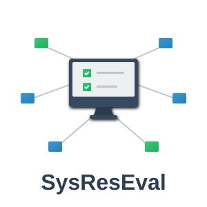

<p align="right">
  <a href="README.md">English</a> · <a href="README.fr.md">Français</a> · <strong>Deutsch</strong>
</p>

<p align="center">
  
</p>

<h1 align="center">SysResEval (SRE)</h1>

<p align="center">
  <a href="https://sysreseval.github.io/sysreseval/html/main/index.html">Hauptdokumentation (HTML)</a> ·
  <a href="https://sysreseval.github.io/sysreseval/html/api/index.html">API-Referenz</a> ·
  <a href="docs/documentation.pdf">PDF-Handbuch</a>
</p>

---

**SysResEval** (*Système Réseaux Évaluation*, kurz **SRE**) ist eine Open-Source-Softwaresuite für den Unterricht und die Verwaltung von Übungen und Prüfungen in Lehrveranstaltungen zur Netzwerk- und Systemadministration.
Jedes „Labor“ oder Projekt ist ein kleines virtuelles Netzwerk aus Linux-Maschinen, das mit dem [Kathara-Framework](https://github.com/KatharaFramework/Kathara) auf Basis von Docker und VDE betrieben wird.
Die Studierenden bearbeiten angeleitete Übungen in einer grafischen Oberfläche;
die Lehrkräfte verfolgen die Sitzungen und führen zeitlich begrenzte Prüfungen mit automatischer, reproduzierbarer Bewertung durch.

Es wird am **IUT d'Orsay, Université Paris-Saclay** entwickelt.

## Höhepunkte

- **Zweistufige Oberfläche.** Eine Desktop-GUI (`sysreseval`) für die Studierenden und eine vollständige Kommandozeile (`sre`) für Lehrkräfte und Autorinnen und Autoren. Die GUI ruft die Kommandozeile über ein kleines setuid-Hilfsprogramm `sre-wrapper` auf, sodass die Rechtegrenzen sauber bleiben.
- **Reichhaltige Laborstruktur.** Jedes Labor bietet mehrere Reiter:
  - **Schema** — die Netzwerktopologie (manche Maschinen können die Verbindung verweigern (in Rot) oder versteckt sein)
  - **Informationen** — allgemeiner Hintergrund und Anweisungen, in Markdown geschrieben.
  - **Fragen** — eine Liste von Aufgaben, die die Studierenden erledigen müssen. Jede Frage ist eines der folgenden:
    - ein Markdown-Text, der eine auf den Maschinen auszuführende Aufgabe beschreibt (z. B. *das Netzwerk auf m1 konfigurieren*),
    - ein Formular, dessen Felder bestimmte Fakten erfassen (z. B. *wie groß ist die MTU von `eth0` auf m1?*); Felder können freier Text sein, der durch einen regulären Ausdruck geprüft wird (z. B. eine IPv4-Adresse), eine Auswahlliste oder ein Kontrollkästchen,
    - eine freie mehrzeilige Textantwort.
  - **Terminals** — eine eingebettete Shell für jede Maschine, mit der sich die Studierenden verbinden dürfen. Ein Labor kann sie als einfache Root-Shells anbieten oder zum Beispiel als `login`-Eingabeaufforderung, die die Studierenden auf ein bestimmtes Benutzerkonto beschränkt.
  - **Maschinen** — eine Statustabelle für jede Maschine: Zustand, NAT-Netzwerk, freigegebene Ports. Die Studierenden können damit separate Terminalsitzungen zu
  einer Maschine öffnen (nützlich, wenn mehrere Terminalsitzungen auf einer Maschine nötig sind)
  - **Netzwerke** — die Netzwerke des Labors mit ihrem Typ: Hub, Switch oder verwaltbarer Switch (mit VLANs und einer Konsole, die die Studierenden öffnen dürfen, wenn das Labor es erlaubt).
  - **Bewertung** — lässt die Studierenden eine automatische Bewertung ihrer Arbeit auslösen und die resultierende Notentabelle ansehen.
  - **Konfiguration anwenden** — lässt die Studierenden das Projekt in einen vordefinierten Zustand versetzen, zum Beispiel eine Teillösung.
- **Hubs, Switches und VLANs.** Jedes Netzwerk eines Labors ist ein Hub, ein Switch oder ein verwaltbarer Switch mit VLANs (Access- und Trunk-Ports) und einer Verwaltungskonsole; Zustände und Bewertung können die Switches steuern und auslesen.
- **Mehrere Labore gleichzeitig geöffnet.** Lehrinhalte können nach Themen statt nach Sitzungen organisiert werden — die Studierenden können mehrere Projekte laufen lassen und zwischen ihnen wechseln.
- **Live-Überblick über den Kurs.** Lehrkräfte können den ganzen Kurs in Echtzeit verfolgen, die letzte Bewertung und die Bewertungsfehler jeder und jedes Studierenden einsehen und Min-/Max-/Durchschnittsstatistiken pro Element über den Kurs hinweg sehen.
- **Zeitlich begrenzte Prüfungen.** `sysreseval` startet das Projekt jeder und jedes Studierenden (sofort oder zu einem geplanten Zeitpunkt), zeigt einen Countdown an, führt regelmäßige Bewertungen aus und zeigt zum Prüfungsende ein Banner an. Die Dauer kann jederzeit angepasst werden — nützlich für Nachteilsausgleiche.
- **Reproduzierbare Bewertung und Werkzeuge für die Zeit nach der Prüfung.** Jede Bewertung wird als komprimierte msgpack-Datei archiviert, die die Projektdaten, die rohen Befehlsausgaben, die Antworten der Studierenden und die Punkte pro Element enthält — jedes Archiv lässt sich mit `sre cat` untersuchen.
Taucht nachträglich ein Bewertungsfehler auf, bewertet `sre re-eval` erneut mit einem aktualisierten Skript; `sre outline` erzeugt anschließend PDF-Berichte pro Studierendem und eine zusammenfassende ODS-Tabelle. Während der Prüfungen wird außerdem jede Terminalsitzung als asciinema-Aufzeichnung für eine spätere Durchsicht gespeichert.
- **Internationalisierbar.** Die Oberfläche (GUI, Kommandozeile, Website) gibt es auf Englisch, Französisch und Deutsch, die Labore auf Französisch und Englisch; Werkzeuge (`prepare-sre-translations`, `add-sre-translations`) machen das mehrsprachige Verfassen einfach.


## Webserver (Fernzugriff)

Die Studierenden können auch in einem **Browser** arbeiten, ohne Desktop-GUI und ohne Remote-Desktop. Die Website `sre-web` authentifiziert sie (LDAP-Verzeichnis oder anonymer Zugang) und zeigt dieselben Reiter wie die GUI, einschließlich der Terminals; die Projekte laufen auf einem **Pool von Docker-Rechnern** (typischerweise die Arbeitsplätze des Unterrichtsraums), die jeweils von einem `sre-agent` gesteuert werden, der die Kommandozeile `sre` im Auftrag der Web-Benutzer ausführt; ein neues Projekt geht an den am wenigsten ausgelasteten Rechner.
Lehrkräfte erhalten eine **Überblicksseite** (das Web-Gegenstück zu `sre watch`), können **das Projekt einer oder eines Studierenden öffnen**, um zu helfen — beide sehen dieselben Terminals und tippen darin —, und können ein Projekt, ihr eigenes oder das einer oder eines Studierenden, in den Browsern des ganzen Kurses oder ausgewählter Studierender **präsentieren**, die auf ihrer eigenen Seite verfolgen, was die Lehrkraft tut (Reiter, Terminals, Fragen). Prüfungen bleiben in der Desktop-GUI.
Siehe **[Web server (remote use)](https://sysreseval.github.io/sysreseval/html/main/web.html)**.


## Beispiel

<p align="center">
  
</p>
<p align="center">
  <a href="https://github.com/sysreseval/sysreseval/raw/main/docs/demo1.mp4">Das Video in voller Qualität herunterladen (MP4)</a>
</p>


## Installation

SRE wird auf einem Linux-Server installiert (Debian/Ubuntu, andere Distributionen mit manueller Installation der Abhängigkeiten).
Produktivinstallationen liegen unter `/opt/sre` und werden typischerweise per NFS im ganzen Unterrichtsraum geteilt.

```bash
git clone https://github.com/sysreseval/sysreseval /opt/sre
cd /opt/sre
sudo ./scripts/install.sh        # interaktiv — etwa 10 Fragen
```

Das Installationsprogramm legt den Systembenutzer `sre` an, richtet eine sudoers-Regel ein, baut den C-Wrapper und die Python-venv, erhöht die inotify-Grenzen des Kernels und installiert (optional) einen `.desktop`-Eintrag, die Bash-Vervollständigung und eine systemd-Unit `sre-preload-images.service`.

Siehe **[docs/sphinx/installation.md](docs/sphinx/installation.md)** für die Einrichtung nach der Installation:
- X so konfigurieren, dass es auf TCP-Port 6000 lauscht,
- den Docker-Zugriff der Studierenden während der Prüfungen einschränken,
- Archivverzeichnisse für die Live-Überwachung teilen,
- Docker-Images vorab laden, um einen Netzwerkzusammenbruch beim Start einer Prüfung zu vermeiden.

Die vollständige Schritt-für-Schritt-Einrichtung, die manuelle Installation und die Schritte nach der Installation sind in **[docs/sphinx/installation.md](docs/sphinx/installation.md)** dokumentiert.


## Dokumentation

Die Dokumentation ist auf Englisch:

- [Overview](https://sysreseval.github.io/sysreseval/html/main/overview.html)
- [Installation & deployment](https://sysreseval.github.io/sysreseval/html/main/installation.html)
- [Running exams](https://sysreseval.github.io/sysreseval/html/main/exam.html) · [exam reference](https://sysreseval.github.io/sysreseval/html/main/exam-reference.html)
- [Web server (remote use)](https://sysreseval.github.io/sysreseval/html/main/web.html)
- [Authoring labs](https://sysreseval.github.io/sysreseval/html/main/lab-authoring.html) · [hubs, switches and VLANs](https://sysreseval.github.io/sysreseval/html/main/switches.html) · [translations](https://sysreseval.github.io/sysreseval/html/main/translations.html)
- [CLI reference](https://sysreseval.github.io/sysreseval/html/main/cli.html) · [GUI reference](https://sysreseval.github.io/sysreseval/html/main/gui.html)
- [Runtime & internals](https://sysreseval.github.io/sysreseval/html/main/internals.html)
